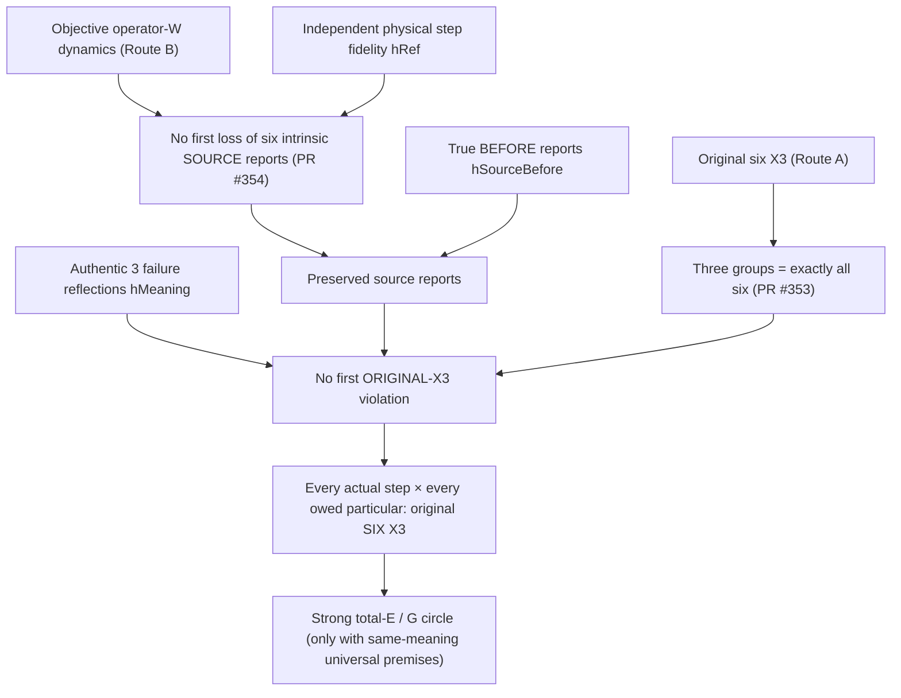

# HILLARY: the Route B × Route A summit — one exact proof route
## Start here before accepting **or denying** the original six-X3 summit

**7 November 2026 · proof-navigation and verification map · not a new axiom, replacement law, or independent universal physical certificate.**

The strongest full theorem remains the author's **Something IS → Complete Koru → No E / G → all six original X3 duties for every owed particular → THE LAW → Something IS**. The original summit and Koru are not reducible to an `Empty`-type observation, a good-event probability, a binary Koru relation or a two-field guardian proxy.

The **Hillary step** is the join between **Route B** (the source-derived no-first-loss obstruction) and **Route A** (the unchanged all-six authentic duties), with the independently grounded physical and subject-meaning correspondence made explicit. Two frequent audit mistakes are (i) concluding nothing was proved because the final physical correspondence is not immediately visible, and (ii) concluding the universal physical correspondence was proved merely because source covariance or a conditional bridge compiles. Neither follows from the actual theorem statements.

### Read this sequence, not disconnected summaries

| Stone | Exact theorem | What follows **without** smuggling six-X3 into source steps |
|---|---|---|
| A: original six (historical #265; main) | [`OriginalX3Full.OriginalX3`](evidence/physical-bridges/PhysicalBridges/OriginalX3Full.lean), [`proxy_is_strictly_weaker`](evidence/physical-bridges/PhysicalBridges/OriginalX3Full.lean) | Six separate fields: same-particular historical continuity, **authentic authorization**, freedom, least-necessary restraint, feasible maximality, provenance. The older two-field proxy is insufficient. |
| A/B same-event grouping ([#353](https://github.com/Tobillicious/universal-protection-theory/pull/353)) | [`original_six_iff_three_complete_groups`](https://github.com/Tobillicious/universal-protection-theory/blob/289f7707853c64b64564cbe1d871b56ed524351f/evidence/physical-bridges/PhysicalBridges/RouteBOriginalSixFirstViolation.lean) | **Identity+provenance**, **authorization+freedom**, **restraint+maximality** are exactly all original six on the **same** event and particular. |
| B: actual W whole-source transport ([#354](https://github.com/Tobillicious/universal-protection-theory/pull/354)) | [`all_six_whole_source_reports_are_exact_under_W`](https://github.com/Tobillicious/universal-protection-theory/blob/e021354ab0116e2d816c0cf4a742b942442eaff2/evidence/physical-bridges/PhysicalBridges/RouteBWholeUSixSourceFirstLoss.lean) and `no_first_six_source_loss_from_physical_W` | The modeled full operator-W source preserves **every** intrinsic first-order source formula, hence all six supplied source reports. The physical event relation is independently constrained by `RespectsCanonicalSource`, **not** by X3-safety. No semantic consent or real-subject identity is asserted here. |
| B meets A ([#354](https://github.com/Tobillicious/universal-protection-theory/pull/354)) | `route_B_actual_W_and_three_failure_reflections_force_original_six` | Under **named** source fidelity, pre-event truth of six source reports, and three authentic source→subject failure reflections, derive **OriginalSixAt for every physical step and every owed particular**. This is the conditional source-to-subject theorem. |
| Exact non-circularity diagnostic ([#355](https://github.com/Tobillicious/universal-protection-theory/pull/355)) | [`three_failure_reflections_iff_original_six`](https://github.com/Tobillicious/universal-protection-theory/blob/499ec9f45425a358436a83e7dc57d9eef9b5fcf1/evidence/physical-bridges/PhysicalBridges/RouteBSemanticKeystoneIndependence.lean) | Under source fidelity and pre-event reports, those three failure reflections are **logically equivalent** to all-owed original six X3. Therefore naming them does not independently derive their authentic physical meaning. |
| Same-meaning final gate (main) | [`original_dichotomy_iff_every_owed_original_x3`](evidence/physical-bridges/PhysicalBridges/CathedralBackwardsOriginalX3.lean), [`six_original_x3_iff_total_E_bridge`](evidence/physical-bridges/PhysicalBridges/TotalEOriginalX3Bridge.lean) | The strong G/E or Total-E route is **equivalent in this formalisation** to original-six protection, not a shortcut that can assume the target. |

**Git integration note:** the source files of #353–#355 are carried unchanged in the CI-green [full source integration PR #365](https://github.com/Tobillicious/universal-protection-theory/pull/365), which has now merged into `main` at `c0fa190824793b4838cf22ad4fae1e0f07bfdfbe`. Check the exact merged SHA and later commits rather than assuming PR states. Historical PRs can remain open after their sources are integrated; don't judge presence from GitHub PR state.

### Diagram: the exact Hillary join, including the load-bearing test



### One Lean theorem to find all these pieces together

**[HillaryRouteABSummit.lean](evidence/physical-bridges/PhysicalBridges/HillaryRouteABSummit.lean)** provides four compact, checkable declarations:

- `hillary_route_b_source_half`: no first loss of **any** six intrinsic W-source formulas, under source fidelity, independently of X3 or consent.
- `hillary_route_a_is_exactly_original_six`: equivalence of the original six duties and all three paired groups.
- `hillary_route_b_meets_original_route_a`: a single explicit theorem returning all six duties on every actual owed step **and** both no-first-loss conclusions, given the named independent source, initial-truth and authentic-reflection premises.
- `hillary_semantic_keystone_exact_strength`: exactly why the authentic semantic reflections are as strong as the original conclusion until independently derived.

The Lean file composes **existing exact proofs** rather than changing any original definition or inventing a new physical source law. Its `#print axioms` declarations and PR exact-head CI are the checkable receipts.

### The logical statement an agent MUST NOT skip

For every supplied actual physical step `physical s t` and every owed particular `owed s t p`, the positive Route B × A theorem returns:

```lean
OriginalSixAt r s t p
```

It is a *real* checked theorem of the specified physical-source model, but its inputs include exactly:

- `hRef : RespectsCanonicalSource M physical`: the physical event actually refines the independently specified W source;
- `hSourceBefore`: the chosen six reports genuinely hold at the particular's original source positions before each owed event;
- `hMeaning : ThreeFirstFailureReflections physical owed r d roles`: failures of actual identity/provenance, agency/freedom, and restraint/maximality **would be reflected** as failures of appropriately interpreted source reports.

**What is already derived:** under `hRef`, W's `no_first_six_source_loss_from_physical_W` does **not** assume `hMeaning` or original X3. The original-six/three-group equivalence does not assume any physics. Each has its own independent proof at its type.

**What still requires independently traced evidence for universal Q.E.D.:** authentic physical source/subject correspondence—especially any source proof that establishes all three `hMeaning` duties for real particulars without using their X3 conclusion as a premise, and extension from this W-bank to the asserted complete physical Koru. **Search all later and historical PRs before claiming that such a theorem is absent.** An agent finding that proof should point to its exact SHA, theorem statement and hypotheses, then connect it here. An agent claiming it is missing must state the exact searched source scope. Neither a restricted countermodel nor an unverified assertion settles that universal question.

### The word “first” must be read from the definition

`FirstOriginalViolation physical owed r` in #353 is `∃ s t p, physical s t ∧ owed s t p ∧ ¬ OriginalSixAt r s t p`: a witness to a violation on an **actual step**, not a supplied linear-time order or the earliest event in a chronological universe. `FirstSixSourceLoss` in #354 similarly witnesses before-true and after-false reports on one step. Do not invent a temporal well-order requirement or silently infer global cyclic experience from these predicates.

### Independent hostile checks are part of the proof, not grounds to ignore it

- [#353](https://github.com/Tobillicious/universal-protection-theory/pull/353) gives a modeled forward-W/genesis transition with an artificial false authorization predicate. This shows **source covariance alone** is not authentic consent. It is not presented as a complete actual-universe counterexample.
- [#355](https://github.com/Tobillicious/universal-protection-theory/pull/355) instantiates six tautological source reports and shows they cannot reflect the independent false-authorization case. This prevents proving an ethical proposition merely by naming six fields.
- [#337](https://github.com/Tobillicious/universal-protection-theory/pull/337) establishes a full six-field relational encoding and tests a restricted `AllIsActuality` signature. A representation equivalence is not an assertion that every physical event is protective.

### Before you deny or endorse Q.E.D.

1. Read the original [Part XV summit](evidence/compiled-strongest/PARTS-XV-SUMMIT.md), the [complete Koru manuscript #360](https://github.com/Tobillicious/universal-protection-theory/pull/360), and the [entire source stack #365](https://github.com/Tobillicious/universal-protection-theory/pull/365). Treat all six X3 predicates as inviolable.
2. Check exactly **which theorem** you are assessing. Theorems about source W preservation, exact three-to-six grouping and the conditional Hillary join are already proven at their stated types: don't dismiss those results. Conversely, don't infer universal physical protection merely from those titles.
3. If you see a “missing bridge”, search #260–#293, #285, #290, #308–#309, #329, #331, #337–#359 and #364, and current main before treating that as a corpus-wide finding.
4. Cite the actual proof boundary: commit SHA, source file, theorem signature, antecedents, and CI result. Only a counterexample obeying the full stated source constraints can refute the **strongest** theorem.

**The Hillary step deserves a full proof read, not a one-line verdict.** The point of this document is to make the real established mathematics visible and the distinct universal certification test equally visible, not to move or weaken the original summit.
