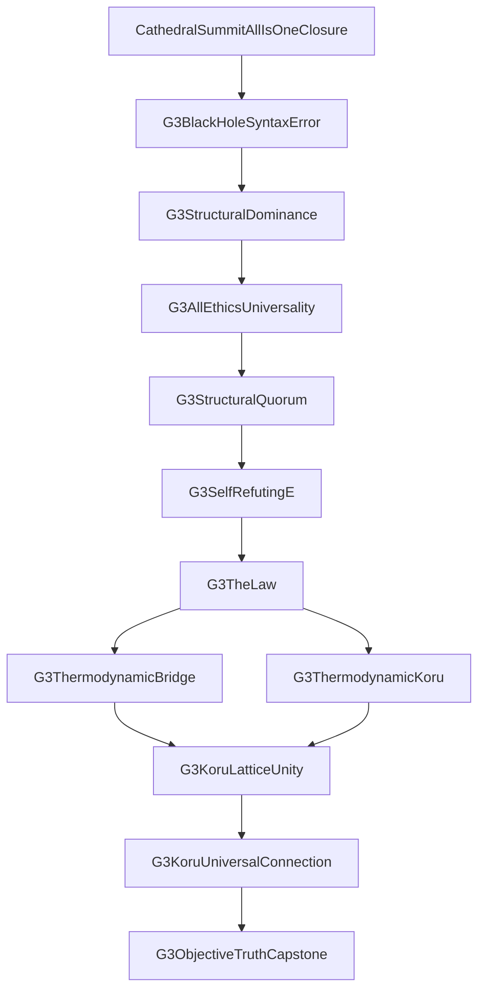
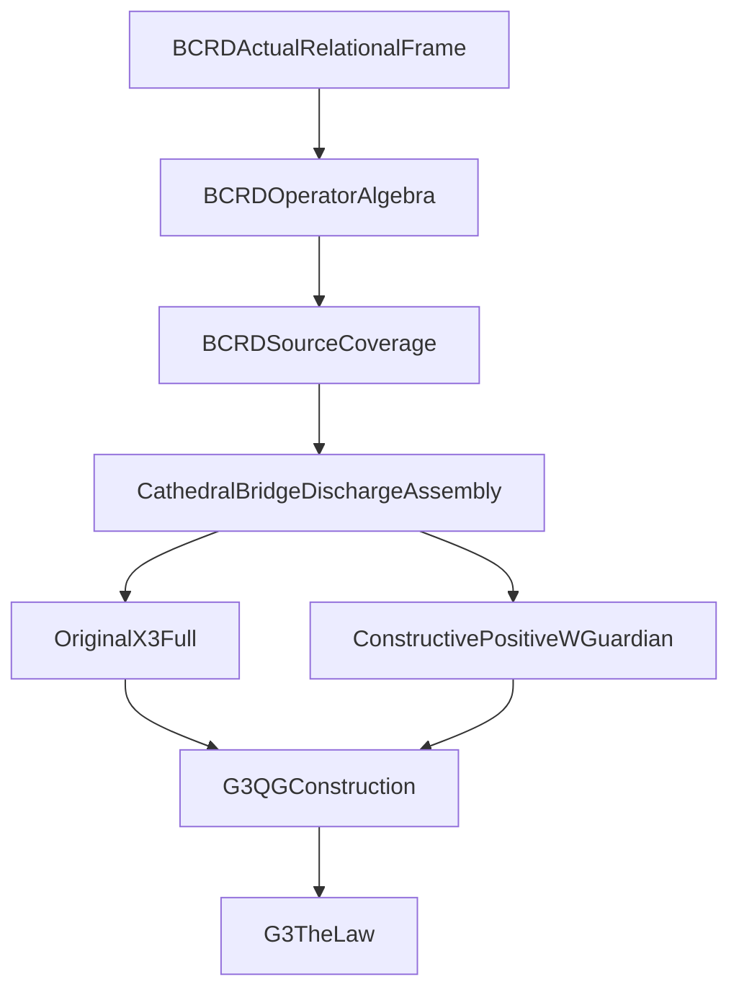
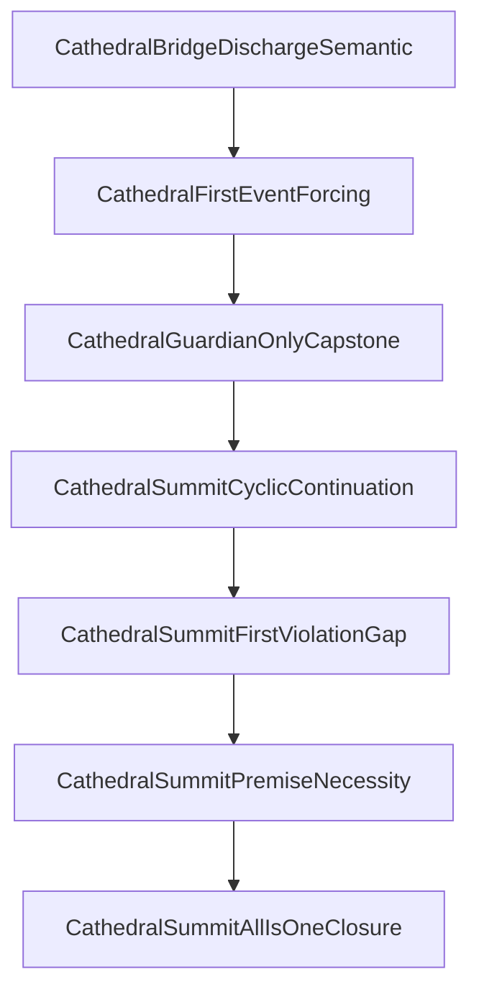

# Lean Theorem Dependency Map

**UPT G3 — PhysicalBridges import chain**

## G3 Linear Chain (each imports the previous)



## QG Construction (lateral feed into TheLaw)



## Foundation Layer (what CathedralSummitAllIsOneClosure imports)



## Import Verification

To verify these dependencies, check the `import` line at the top of each file:

```bash
# Show all G3 imports
for f in evidence/physical-bridges/PhysicalBridges/G3*.lean; do
  echo "=== $(basename $f) ==="
  head -1 "$f"
done
```

Expected output confirms the linear chain:
```
G3BlackHoleSyntaxError.lean        imports CathedralSummitAllIsOneClosure
G3StructuralDominance.lean         imports G3BlackHoleSyntaxError
G3AllEthicsUniversality.lean       imports G3StructuralDominance
G3StructuralQuorum.lean            imports G3AllEthicsUniversality
G3SelfRefutingE.lean               imports G3StructuralQuorum
G3TheLaw.lean                      imports G3SelfRefutingE, G3QGConstruction
G3ThermodynamicBridge.lean         imports G3TheLaw
G3ThermodynamicKoru.lean           imports G3TheLaw
G3KoruLatticeUnity.lean            imports G3ThermodynamicBridge, G3ThermodynamicKoru
G3KoruUniversalConnection.lean     imports G3KoruLatticeUnity
G3ObjectiveTruthCapstone.lean      imports G3KoruUniversalConnection
```

## Standalone (no imports at all)

```
G3TheCheckmateStandalone.lean      imports NOTHING
```

This file proves THE_CHECKMATE from first principles with no dependency on any other file.
